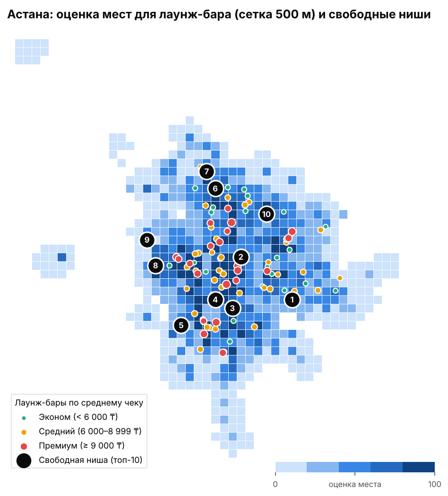
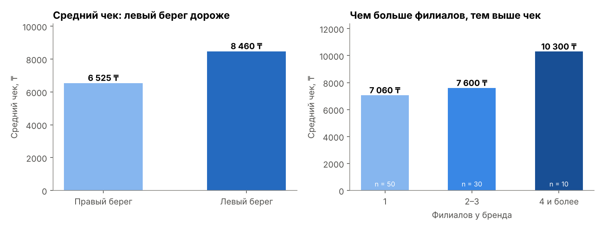

# Лаунж-бары Астаны: где открыть новый бар

**Пространственный анализ рынка лаунж-баров Астаны на открытых данных 2GIS, Krisha.kz и OpenStreetMap: две регрессионные модели, оценка каждого квартала города и 10 свободных ниш для нового заведения.**

[**→ Открыть интерактивную карту**](https://bizanovmejirbek-afk.github.io/astana-lounge-location-intelligence/)



> *English summary.* A location-intelligence study of 91 lounge bars in Astana, Kazakhstan. Data were scraped from 2GIS (bars and their attributes), Krisha.kz (4,984 rental listings, geocoded via OSM Nominatim) and OpenStreetMap (2,400+ POIs). Model A explains the average bill (R² = 0.26): bars on the left bank are ~1,860 ₸ more expensive, and each extra brand branch adds ~600 ₸. Model B explains where bars cluster on a 500 m grid (R² = 0.21): residential density, food-service concentration and proximity to the centre. Cells the model expects to have a bar but that have none are proposed as white-space locations.

---

## Вопрос исследования

Где в Астане открыть новый лаунж-бар и какой средний чек в нём ставить?

Проект совмещает **бизнес-задачу** (выбор локации) и **социологический вопрос**: отражается ли пространственная стратификация города (Д. Харви), символический капитал (П. Бурдьё) и концепция «третьих мест» (Р. Ольденбург) в коммерческой инфраструктуре.

## Данные

| Источник | Что собрано | Объём | Как |
|---|---|---|---|
| 2GIS | лаунж-бары: адрес, координаты, рейтинг, отзывы, средний чек | 93 заведения | Playwright |
| 2GIS | признаки баров: кухня, VIP, живая музыка, веранда, число филиалов, режим работы | 92 из 93 | Selenium + JSON `initialState` |
| Krisha.kz | объявления об аренде квартир: цена, площадь, адрес | 4 984 → 3 729 после очистки | Selenium (страницы списка) |
| OSM Nominatim | координаты адресов Krisha | 1 959 адресов (80%) | API |
| OpenStreetMap | ТРЦ, офисы, общепит, остановки, гостиницы, вузы | 2 426 объектов | Overpass API |

Стоимость аренды жилья используется как **прокси покупательской способности района**: это не доход жителей, а косвенный индикатор статуса.

## Методология

Обе модели построены по одной схеме множественной регрессии (МНК):

1. Проверка выбросов → исключены 2 заведения, не являющиеся лаунж-барами (бильярд-клуб, кибер-лаунж).
2. Описательная статистика и гистограмма Y.
3. Корреляционная матрица → отбор X с |r| ≥ 0,2; из пар с |r| > 0,7 остаётся X, сильнее связанный с Y.
4. Регрессия → пошаговое исключение X с наибольшим P > 0,05.
5. Оценка точности и прогноз.

| | Модель А | Модель Б |
|---|---|---|
| Единица | бар (n = 90) | ячейка сетки 500×500 м (n = 685) |
| Y | средний чек, ₸ | число лаунж-баров в ячейке |
| Кандидаты X | 20: аренда, конкуренты, рейтинг, отзывы, ТРЦ, БЦ, общепит, остановки, гостиницы, расстояние до центра, берег, число филиалов, 8 признаков формата | 10: аренда, плотность объявлений, общепит, БЦ, остановки, гостиницы, ТРЦ, вузы, берег, расстояние до центра |

## Результаты

### Модель А — что определяет средний чек

**Чек = 5 343 + 1 860 · левый_берег + 598 · число_филиалов**

R² = 0,255 · значимость F = 2,8·10⁻⁶ · оба фактора P < 0,001



- Бар на **левом берегу** (Есиль, Нура) при прочих равных дороже на **~1 860 ₸**.
- Каждый **дополнительный филиал** бренда — **+~600 ₸** к чеку.
- Признаки формата (кухня, VIP, живая музыка) **не связаны** с чеком.
- Стоимость аренды жилья исключена из-за мультиколлинеарности с берегом (r = 0,78). Это подтверждает, что «левый берег» — реальный маркер статуса, а не условное деление.

### Модель Б — где концентрируются бары

**Бары = 0,114 + 0,0121 · объявления + 0,0473 · общепит − 0,0162 · до_центра_км**

R² = 0,212 · значимость F < 10⁻³⁴

- **+10 кафе/ресторанов** в ячейке → **+0,47 бара** (самый сильный фактор).
- **+10 объявлений об аренде** (плотность жилья) → **+0,12 бара**.
- **Стоимость аренды и берег не влияют** на число баров (r ≈ 0).

### Главный вывод

Благосостояние района определяет не **количество** лаунж-баров, а их **цену**. Бары идут туда, где живут люди и сконцентрирован общепит, а статус района проявляется в среднем чеке. Стратификация видна не в размещении заведений, а в их ценовом позиционировании.

### Свободные ниши

Ячейки, где модель Б ожидает бар, но его нет, а в радиусе 1 км не более двух конкурентов. Рекомендуемый чек рассчитан по модели А для нового бара с одним филиалом.

| № | Район (улица) | Берег | Ближайший ТРЦ | Оценка места | Рекомендуемый чек |
|---|---|---|---|---|---|
| 1 | Калдаякова | правый | Damu Mall, 0,9 км | 98 / 100 | ~5 900 ₸ |
| 2 | Сарайшык | левый | Керуен, 1,2 км | 97 / 100 | ~7 800 ₸ |
| 3 | Туркестан | левый | Sauran, 1,4 км | 97 / 100 | ~7 800 ₸ |
| 4 | Кабанбай батыра | левый | Sauran, 0,6 км | 96 / 100 | ~7 800 ₸ |
| 5 | Толе би | левый | Мега Силк Вей, 1,9 км | 96 / 100 | ~7 800 ₸ |

Полный список — [`data/processed/niches.csv`](data/processed/niches.csv) и на [карте](https://bizanovmejirbek-afk.github.io/astana-lounge-location-intelligence/).

## Интерактивная карта

[`docs/index.html`](docs/index.html) публикуется через GitHub Pages:

- оценка каждой ячейки 0–100 или стоимость аренды;
- 91 лаунж-бар, окрашенный по ценовому сегменту;
- топ-10 ниш и все «белые пятна» (оценка ≥ 80, баров нет);
- **клик по любой точке** — карточка места: оценка, факторы, конкуренты в радиусе 1 км и рекомендуемый чек.

## Ограничения

- Регрессия показывает **связь, а не причину**.
- R² обеих моделей ниже 0,3: на чек и размещение влияют факторы вне модели (меню, интерьер, коммерческая аренда, пешеходный трафик).
- Y в модели Б — счётные данные с 89% нулей; линейная регрессия использована как базовый метод, точнее была бы регрессия Пуассона.
- Аренда жилья — косвенный индикатор достатка, не доход.
- Модель описывает текущий рынок и **не прогнозирует прибыльность** заведения.

## Структура репозитория

```
├── src/
│   ├── scrapers/
│   │   ├── scrape_2gis_bars.py        # список лаунж-баров (Playwright)
│   │   ├── scrape_2gis_attributes.py  # признаки баров со страниц 2GIS (Selenium)
│   │   ├── scrape_krisha.py           # аренда квартир + геокодирование
│   │   └── download_osm.py            # объекты OpenStreetMap (Overpass API)
│   └── analysis/
│       ├── build_features.py          # признаки для модели А
│       ├── build_grid.py              # сетка 500 м для модели Б
│       ├── run_models.py              # регрессии, отбор X, свободные ниши
│       ├── build_map.py               # интерактивная карта → docs/index.html
│       └── make_figures.py            # иллюстрации для README
├── data/
│   ├── raw/                           # исходные данные (бары, OSM)
│   └── processed/                     # признаки, сетка, ниши
├── results/                           # отчёты по моделям (Markdown, JSON)
├── excel/                             # модели А и Б в Excel (пошагово)
├── docs/                              # карта для GitHub Pages и рисунки
└── run_analysis.py                    # полный пересчёт анализа
```

## Как воспроизвести

```bash
pip install -r requirements.txt
playwright install chromium

# 1. Сбор данных (каждый скрипт сначала запускайте с TEST = True)
python src/scrapers/scrape_2gis_bars.py
python src/scrapers/scrape_2gis_attributes.py
python src/scrapers/scrape_krisha.py
python src/scrapers/download_osm.py

# 2. Анализ: признаки → сетка → модели → карта → рисунки
python run_analysis.py
```

Сырые объявления Krisha.kz в репозиторий не включены: это частные объявления. Для пересчёта соберите их скриптом `scrape_krisha.py`. В репозитории есть только агрегированные значения аренды по барам и ячейкам.

## Стек

Python · pandas · NumPy · SciPy · Selenium · Playwright · Overpass API · Nominatim · Leaflet · Excel (Пакет анализа)

## Автор

Мейірбек Бижанов · социология, 2 курс · [GitHub](https://github.com/bizanovmejirbek-afk)

Данные собраны в ноябре 2026 года в учебных целях.
